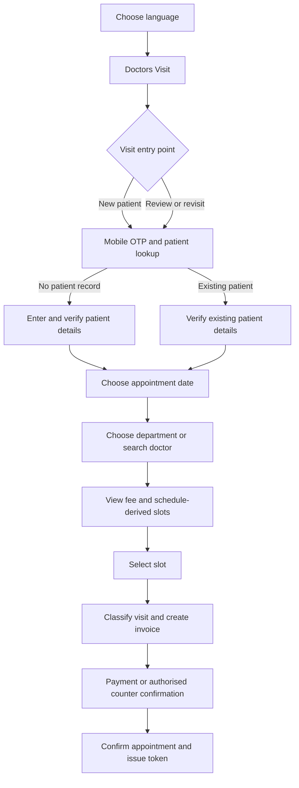

# Vitalyes Hospital Operations Intelligence Platform

## Product requirements and architecture baseline

**Status:** Product-owner approved baseline for the next implementation iteration; unresolved decisions remain open as recorded in Section 12  
**Scope:** Product definition and implementation design; this document does not approve production use or replace security, privacy, legal, clinical, or operational review.

This baseline consolidates the requested product vision into a workflow, functional requirements, data model, integration outline, role model, delivery plan, and acceptance criteria. Items marked **Decision required** need approval before the affected workflow is treated as final. Proposed defaults are explicit so they can be reviewed and changed without silently becoming policy.

## 1. Product scope

Vitalyes is a configurable, multi-hospital outpatient operations platform. Its initial module covers patient identification and registration, doctor appointments, invoicing, payments, tokens, patient flow, and operational reporting. It is not a replacement for a hospital's clinical record or HIS/HMIS.

### Product principle

> **One common application, multiple hospital configurations, independent business rules, and centralised intelligence.**

This principle is an architecture constraint, not just a deployment preference:

- Maintain one versioned product and API; do not create customer-specific code forks for fees, schedules, review rules, tokens, workflows, or reports.
- Resolve and authorize the hospital context on every staff request. Hospital-owned records, configuration, permissions, and uniqueness rules are tenant-scoped.
- Model operational rules as validated, versioned hospital configuration with effective dates. Snapshot the applied configuration and prices onto transactions so later changes do not rewrite history.
- Feed central BI from tenant-aware events/read models. Cross-hospital aggregation is a distinct, explicitly authorized use case; it must not expose patient-level records by default.
- Keep shared platform capabilities separate from hospital-specific operational data and settings. A hospital must not be able to change another hospital's configuration or access its records.

The current JSON-backed prototype demonstrates workflows only. It does not satisfy the tenant isolation, transaction safety, or central analytics requirements for a commercial deployment.

### Phase 1 MVP

- English, Malayalam, and Hindi user interface, selected on the home screen.
- Patient lookup by mobile OTP or hospital MRN with OTP; new-patient registration and duplicate checks.
- Doctors Visit entry points for New Patient Registration, Review / Follow-up, and Revisit / New Consultation.
- Appointment date selection before department or doctor selection.
- Doctor and department search, schedule-derived slots, and previous-doctor guidance for returning patients.
- Hospital-configurable doctor schedules, consultation fees, slot duration and capacity, and review-period policy.
- New / Review / Revisit classification, invoice, simulated payment, and doctor/date token.
- Basic operational reports and structured demographic capture.
- Relational data model and API boundaries suitable for a later multi-hospital deployment.

### Later phases

- Phase 2: authenticated administrative configuration, full schedule exceptions, live payments, reconciliation/refunds, operational and demographic BI, and patient-flow metrics.
- Phase 3: catchment-area analytics, strategic dashboards, capacity planning, and validated demand forecasting. The prototype now includes exploratory six-month projections, not validated forecasts or staffing recommendations.
- Phase 4: external HIS/HMIS integrations, multi-hospital analytics, and carefully validated AI-assisted recommendations.

Real payment processing, Aadhaar retrieval, predictive recommendations, and production patient-data handling are not part of the demo MVP.

### Front-end access

Keep the patient home screen focused on the three visit actions: New Patient Registration, Review / Follow-up, and Revisit / New Consultation. Administration and analytics belong in a visually separate staff portal with a sign-in screen and distinct Overview, Daily Operations, Analytics, and Settings pages. Show pages and navigation according to the authenticated staff permissions; if OIDC is not configured, explain that staff sign-in is unavailable rather than hiding the portal or implying authentication succeeded.

## 2. User roles and principal journeys

### Patient journey

### Workflow requirements

1. **Language and accessibility:** Persist the selected language during the journey. Provide responsive, touch-friendly controls, readable validation and error messages, keyboard accessibility, and a kiosk inactivity warning/reset that does not expose the prior patient's details.
2. **Patient identification:** Mobile OTP and MRN lookup are separate paths. MRN lookup sends OTP to the number already on file. A successful lookup displays: “We have identified your existing patient record. Please verify your details and proceed.”
3. **New patient registration:** Require first and last name, date of birth, gender, mobile, address, post office, PIN code, district, and state. Alternate mobile, email, and blood group are optional. Validate date of birth and address fields; allow the patient to review and correct all prefilled values before saving.
4. **Duplicate prevention:** Check hospital-scoped identity records before creating a chart. Do not automatically merge records based on a shared mobile number alone. Route ambiguous matches to an authorised staff resolution workflow.
5. **Appointment date first:** Show dates with at least one bookable doctor slot, derived from configured schedules and current reservations. After date selection, offer department filtering or doctor-name search. Show doctor, department, fee, and actual available times.
6. **Returning patients:** Identify the most recent completed consultation. Recommend the same doctor for a review/revisit. A different doctor or specialty is classified as a new consultation. The patient may proceed with another doctor, but the applicable category and fee must be clear before invoicing.
7. **Invoice and payment:** Create an invoice after slot selection. Store immutable patient, provider, visit-category, price, and tax snapshots on the invoice. Confirm an appointment and issue its token only after successful payment or an authorised counter workflow.
8. **Confirmation:** Display patient name, hospital MRN, doctor, department, local appointment date/time, token, and payment status. Provide the reporting instruction and accessible print/download support when available.

### Complete workflow validation before implementation

Review the end-to-end patient, front-office, finance, and administration journeys before approving the next build iteration. Validate both the normal path and the state transitions below:

| Workflow | Required scenarios and invariants |
|---|---|
| Hospital onboarding | Create a hospital and its configuration; assign staff roles and hospital scope; verify a second hospital cannot view or mutate the first hospital's configuration or transactions. |
| Patient identity | New patient; existing patient by verified mobile; existing patient by MRN with OTP to the registered contact; duplicate or ambiguous identity; shared contact number; patient correction; consent and identity-resolution boundaries. |
| Appointment | Search date, department, and doctor; confirm availability; concurrent booking for the final slot; payment hold expiry; schedule/configuration change during a hold; reschedule; walk-in/queue if approved. |
| Visit classification | First visit; same-doctor review inside and at the expiry boundary; one-time or repeated entitlement use; revisit after expiry; different doctor; cancellation/no-show without incorrectly consuming review eligibility. |
| Invoice and payment | Price/configuration snapshot; partial/failed/retried payment; duplicate/out-of-order provider callbacks; authorised counter collection; refund and reconciliation; appointment/token creation exactly once after valid settlement. |
| Patient flow | Check-in/arrival, token issue and display, queue status, consultation start/completion, no-show and cancellation; preserve timestamp source and report coverage rather than infer missing events. |
| Reporting and governance | Operational, demographic, finance, and strategic views; hospital/department role scopes; date/filter correctness; export authorization; privacy thresholds; period comparison and target definitions. |
| Administration and integration | Effective-dated configuration changes and audit trail; payment/SMS/HIS outage and retry; idempotency; reconciliation and recovery after interrupted transactions. |

For each workflow, record the actor, preconditions, successful result, failure/timeout result, transaction boundary, audit event, and acceptance test. Do not start the next implementation iteration until hospital operations, finance, product, and technical owners approve the workflow and the unresolved decisions in Section 12.

## 3. Scheduling and visit rules

### Schedule configuration

Each hospital/provider schedule must support:

- Recurring working weekdays and one or more sessions with start/end times.
- Slot duration, capacity per slot, consultation fee, and optional session-specific overrides.
- Breaks and unavailable intervals for lunch, rounds, OT, leave, and other commitments.
- Dated exceptions: provider unavailable, or a special working day that replaces the recurring pattern.
- Effective dates, time zone, active/inactive state, and an audit record for each change.

An interval is bookable only when the full slot falls within a working session, does not overlap a break/unavailable interval, is in the future in the hospital's time zone, and has remaining capacity. A special working day replaces the recurring day. An explicit unavailable exception takes precedence over a special working day; conflicting exceptions must be rejected or resolved by an administrator. No random or client-generated slots are accepted.

Before confirming a reservation, the server revalidates the slot and atomically reserves capacity. A temporary unpaid hold has a configurable expiry. Expired holds release capacity. Concurrent requests for the last available capacity must not both succeed. Rescheduling releases the old reservation and reserves the new one in a single transaction.

When a selected date has no slots for a chosen doctor, show the nearest available date(s) before and after the requested date when they exist. Results must never suggest dates outside configured availability.

### Review, revisit, and new consultation

- A review is free only for the same patient and same doctor as a qualifying completed consultation, within the hospital's configured review window.
- A return after that window with the same doctor is a chargeable revisit and starts a new review window after the revisit itself is completed.
- A different doctor or specialty is a chargeable new consultation; it does not consume another doctor's review entitlement.
- Eligibility is based on a completed consultation, not merely a booked or paid appointment. The invoice and appointment retain the source consultation/entitlement reference.
- Show the category, zero or applicable consultation fee, and review expiry date before invoice confirmation.
- Re-evaluate eligibility on reservation/confirmation using the hospital-local appointment date. If an appointment is moved beyond the eligibility period, recalculate and obtain payment for any resulting charge before confirmation.

**Proposed default:** retain the prototype's `calendar_days_inclusive` convention: the consultation date is day 1, so a 15-day period expires at the end of the 14th calendar day after consultation. Store the policy on the hospital and snapshot the policy/version and computed expiry on the entitlement/appointment. The policy must be configurable and applied consistently.

**Decision required:** confirm whether an entitlement can be used for one completed free review only, or for multiple reviews during its validity period. Proposed default is one completed free review per source consultation, to prevent repeated free bookings; cancellations/no-shows do not consume it.

## 4. Invoicing, payments, and tokens

### Invoice and payment lifecycle

1. Validate patient, doctor, schedule, slot capacity, visit classification, and current price.
2. In one database transaction, create an expiring slot hold and a draft/issued invoice with line items (registration, consultation, and configured additional charges).
3. Record each payment attempt with method, provider reference, amount, status, timestamps, and idempotency key. A failed attempt remains auditable and does not confirm the appointment.
4. On verified successful payment, or authorised counter confirmation, mark the invoice paid, confirm the appointment, and issue a token atomically. Duplicate gateway callbacks must be idempotent.
5. A refund is a separate, auditable transaction linked to the original payment; do not delete or rewrite the original payment record.

Payment methods include UPI, debit/credit card, net banking, cash/manual counter payment, and hospital-enabled methods. Production integrations must use a payment provider; Vitalyes must not store card credentials. Simulated payments are allowed only in demo/test mode and must be visibly labelled.

### Token rules

- Proposed format: `{doctorCode}-{DDMMYY}-{sequence}`, e.g. `DOC01-101126-001`; date is the hospital-local appointment date.
- Sequence scope: hospital + doctor + appointment date. Sequence allocation is atomic and never reuses a number after cancellation.
- Token lifecycle includes active, cancelled, and superseded/rescheduled states; changes preserve the original token and an audit trail.
- A confirmed booking has one current token. Payment failure or an expired hold cannot produce an active token.

## 5. Administrative configuration

Authorised administrators configure hospital identity, time zone, currency, supported languages, departments, provider affiliations, fees, registration charges, schedules, capacity, review rules, slot-hold duration, token format, payment methods, user access, retention settings, and report access.

Configuration changes are hospital-scoped, effective-dated where appropriate, validated before activation, and audited with actor, timestamp, old/new values, and reason. Existing invoices, appointments, and tokens retain the configuration and price snapshots under which they were created. Cross-hospital administration requires an explicitly granted system-administrator scope and must be audited.

## 6. Relational data model

Use a relational OLTP database (PostgreSQL is the proposed default) for transactional data. Use generated UUID primary keys; human-readable MRNs, invoice numbers, and tokens are scoped business identifiers, not primary keys.

The first PostgreSQL foundation migration is `db/migrations/001_initial_schema.sql`. It defines tenant-composite keys/foreign keys, versioned hospital settings, core OP transactions, OIDC role/group assignments, integration/outbox records, and row-level hospital policies. It is not connected to the JSON-backed demo server and must be applied and tested against a provisioned PostgreSQL environment before application cutover.

### Tenant and relational integrity rules

- Every hospital-owned table carries a non-null `hospital_id`; global reference tables are explicitly identified and cannot contain hospital transactions.
- Define composite unique keys and foreign keys that include `hospital_id` (for example `(hospital_id, doctor_id)` and `(hospital_id, appointment_id)`) so a valid identifier from one tenant cannot be attached to another tenant's row.
- Set tenant context from the authenticated identity and the requested resource, then enforce it in the service layer and database policy/transaction. Never trust a client-supplied `hospital_id` as authorization.
- Set the verified hospital context transaction-locally (for example with `set_config('vitalyes.hospital_id', ..., true)`) on every pooled database transaction; unset/invalid context must fail closed. Cross-hospital administration requires a separately audited, explicitly authorized workflow rather than bypassing row-level security.
- Separate a shared platform patient identity from each hospital's chart/MRN. Linking identities across hospitals is opt-in, purpose-limited, and separately authorized; do not infer a global identity from a mobile number.
- Keep transactional writes in the OLTP database. Publish versioned, idempotent domain events through an outbox to tenant-aware reporting projections; central BI must not query or bypass OLTP authorization.
- Store structured, typed business configuration with validation, versions, effective dates, and audit history. Avoid executable or unvalidated arbitrary settings. Transactions retain the exact configuration/price snapshot used.

### Core entities

| Entity | Important attributes and constraints |
|---|---|
| `hospital` | ID, code, name, IANA time zone, currency, active state; unique hospital code. |
| `hospital_setting` | Hospital, setting key/value, effective dates, version; unique hospital + key + version. Store typed/validated configuration, not arbitrary executable content. |
| `department` | Hospital, code, localized names, active state; unique hospital + code. |
| `doctor` | Provider identity, localized/display name, doctor code, active state. |
| `doctor_department` | Hospital, doctor, department, effective dates; supports hospital-specific affiliations. |
| `doctor_schedule_rule` | Hospital, doctor, weekday, session interval, effective dates, duration, capacity, fee. |
| `schedule_exception` | Hospital, doctor, date/interval, unavailable or replacement session, reason, actor. |
| `patient` | Platform patient UUID and minimal shared identity data; no global MRN. |
| `hospital_patient` | Hospital, patient, hospital MRN, local chart status; unique hospital + MRN and hospital + patient. |
| `patient_contact` | Patient, type, normalized value, verification state, validity dates; protect contact data. |
| `patient_address` | Patient/hospital scope, address/locality, post office, PIN, district, state, country, source, validity dates. |
| `identity_consent` | Patient, hospital, purpose, source, consent wording/version, grant/withdraw timestamps. |
| `consultation` | Hospital, hospital patient, doctor, department, completed date/time, status, source encounter; only completed records establish review eligibility. |
| `review_entitlement` | Hospital, patient, source consultation, doctor, policy snapshot, start/expiry, state, consumed consultation; unique/locking rules enforce approved use count. |
| `appointment` | Hospital, patient, provider, department, slot, visit category, source entitlement, status, hold expiry, timestamps. |
| `invoice` / `invoice_line` | Hospital, appointment, unique invoice number, currency, line descriptions, quantity, unit amount, tax, totals, status, configuration/price snapshot. |
| `payment` | Hospital, invoice, method, provider reference, idempotency key, amount, status, timestamps; provider reference unique within provider/account. |
| `refund` | Hospital, original payment, amount, reason, status, provider reference, actor and timestamps. |
| `token` | Hospital, appointment, doctor, local service date, sequence, rendered token, status; unique hospital + doctor + date + sequence. |
| `app_user` / `role` / `permission` | Identity-provider subject, role and permission assignments, hospital scope, effective dates. |
| `audit_event` | Hospital, actor/service, action, entity reference, timestamp, correlation ID, minimal before/after metadata. Do not copy unnecessary patient data into logs. |
| `outbox_event` | Transactional event ID, hospital, event type, payload version, occurred/published timestamps; supports reliable analytics/integration delivery. |

### Tenant and privacy invariants

- Every hospital-owned row includes `hospital_id`; enforce tenant scope in service authorization and database policies where supported.
- A patient may have a separate MRN/chart at each hospital. Cross-hospital linking is an explicit, controlled identity-resolution capability; mobile number alone is not proof of identity.
- Store only the minimum identity data required. Encrypt sensitive data at rest and in transit, restrict access, mask identifiers in routine screens/logs, and keep audit access controlled.
- Aadhaar is out of MVP. Any later integration requires authorised provider/API, purpose limitation, explicit consent, and legal/privacy review. Do not store full Aadhaar numbers; use provider-approved reference/token mechanisms.
- BI exports and dashboards use aggregated or de-identified data by default. Drill-down requires a permitted role, hospital scope, and audit event.

## 7. Application and integration architecture

### Proposed deployment shape

- **Web clients:** responsive patient kiosk/mobile web UI and a separately authenticated staff/admin UI.
- **API:** versioned HTTPS REST API, proposed `/api/v1`, with server-side validation and authorization. Keep a modular monolith for the MVP; split services only when operational scaling requires it.
- **Transactional store:** PostgreSQL with schema migrations, foreign keys, unique constraints, and transactional slot/payment/token workflows.
- **Background processing:** transactional outbox and retryable workers for payment callbacks, notifications, reporting projections, and external integrations.
- **Analytics:** separate reporting schema/read model, initially populated from outbox events or CDC; avoid expensive analytical queries against the live booking path. Add a warehouse when scale and reporting needs justify it.
- **Integrations:** adapters for OTP/SMS, payment provider, authorized identity service, and external HIS/HMIS. Use provider webhooks with signature verification, idempotency, timeouts, retries, and reconciliation.
- **Operations:** structured logs without unnecessary PHI, metrics, tracing/correlation IDs, backups, restore tests, alerting, secret management, and documented retention/deletion policies.

### API capability outline

| Capability | Example resource/action |
|---|---|
| Configuration | `GET /api/v1/public/config`; authenticated hospital-scoped admin CRUD for departments, doctors, fees, rules, and schedules. |
| Identity | `POST /api/v1/identity/otp`; `POST /api/v1/identity/verify`; `POST /api/v1/patients/lookup/mrn`; patient create/update with verified session and duplicate review. |
| Availability | `GET /api/v1/availability/dates`; `GET /api/v1/availability/slots?date=...&departmentId=...&doctorId=...`. |
| Appointments | `POST /api/v1/appointments/holds`; `POST /api/v1/appointments/{id}/confirm`; authorised cancel/reschedule actions. Requests use idempotency keys. |
| Billing | `POST /api/v1/appointments/{id}/invoice`; `GET /api/v1/invoices/{id}`; payment initiation and authorised counter confirmation. |
| Payments | Provider callback endpoint, payment status, refund request, and reconciliation resources restricted by role. |
| Tokens | Issue as part of successful confirmation; authorised token lookup/cancel/reschedule endpoints. |
| Reporting | Role-scoped aggregate endpoints with date range, hospital, department, doctor, demographic, and geography filters. |
| Integrations | Versioned, authenticated HIS/HMIS exchange endpoints with external identifiers, mapping, idempotency, and audit. |

This is a capability outline, not a finalized external API contract. API schemas, error codes, authentication flows, and compatibility/versioning policy are Phase 1 design outputs.

## 8. Access control and governance

Use an established OIDC identity provider for staff accounts; require MFA for privileged roles. Patient OTP is limited to patient identity/session verification and is not staff authentication. Apply least privilege, hospital-scoped access, session expiry, rate limits, and audited administrative actions.

| Role | Permitted scope |
|---|---|
| Front office | Patient lookup/registration, appointment booking, invoice and authorised collection workflows, token operations for assigned hospital. |
| Department head | Aggregated department reports, schedule/capacity views, and permitted department-level operational drill-down. |
| Hospital administration | Hospital-wide operational, appointment, capacity, and patient-flow reports; configuration only if separately granted. |
| Finance | Invoices, collections, payment failures, refunds, and reconciliation for assigned hospital(s). |
| Director/management | Hospital-scoped aggregate dashboards, trends, and strategic analytics; identifiable detail only if separately justified and granted. |
| Vitalyes system administrator | Technical monitoring and explicitly assigned tenant configuration; cross-hospital patient/clinical access is not implied. |

Authorization must be checked on every API request and export. Reports must apply row-level hospital/department scope before aggregation and drill-down.

## 9. Reporting and metric definitions

All reports support hospital-local date ranges and role-appropriate filters. Date range, filter values, metric definitions, and report generation time accompany exported files.

### Operational reports

Daily registrations; new/existing patients; department/provider registrations; appointments/bookings; new/review/revisit mix; cancellations/no-shows; tokens; payment collections/failures/refunds by method; pending consultations; hourly footfall; scheduled versus actual consultation start; and token-to-consultation wait time.

### Demographic and strategic analysis

Age bands (0–5, 6–12, 13–18, 19–30, 31–45, 46–60, 61–75, 76+), dynamically calculated at report date; gender and age/gender cross-tabs; state/district/PIN/post-office/locality distribution; new-patient acquisition and repeat frequency; department preference; revenue by geography; patient catchment dashboard; volume, revenue, capacity, provider utilization, waiting-time, and demand-versus-capacity trends.

### Metric definitions to standardize

- **Footfall:** distinct completed OP consultations for the selected period; show registrations and bookings separately.
- **New patient:** first hospital chart/registration at that hospital; do not equate to first-ever Vitalyes use unless identity linking supports it.
- **Returning patient:** patient with a prior completed consultation at that hospital.
- **No-show:** confirmed appointment with no consultation and no timely cancellation, according to a configurable hospital cutoff.
- **Slot utilization:** reserved/confirmed capacity divided by published bookable capacity for the same hospital, provider, and period; report cancelled slots separately.
- **Revenue collected:** successful captured payments less completed refunds, by transaction time; distinguish invoiced, collected, and recognized revenue.
- **Wait time:** actual consultation start minus patient arrival/check-in time. If either timestamp is absent, do not infer a wait time; report coverage.
- **Appointment adherence:** actual consultation start minus scheduled start; define an explicit tolerance band before publishing late/on-time rates.
- **Average consultation duration:** completed consultation end minus start; exclude or separately report records missing either timestamp.

**Decision required:** Finance and operations must approve accounting definitions, cancellation/no-show cutoffs, arrival capture, and the source of actual consultation timestamps before management KPIs are considered authoritative. Geography should be reported only at a granularity that protects privacy and has adequate sample sizes.

Validated forecasting and AI recommendations remain deferred until data quality, minimum history, validation method, confidence display, and human approval rules are agreed. The prototype's department projection is a simple six-month linear trend, shown only when that department has completed visits in each of the six consecutive months before the report month. This activity-based coverage check is not proof of complete source data; projections are exploratory, use current schedules for future capacity, and must not be treated as staffing instructions. Journey drop-off is measured from anonymous random journey IDs and stage timestamps, excluding events less than 15 minutes old. Initial dashboards are descriptive/diagnostic, not automated clinical or staffing decisions.

## 10. Delivery milestones and validation

| Milestone | Scope | Exit evidence |
|---|---|---|
| 0. Product and policy sign-off | Approve the workflow catalogue, relational model, tenant/data invariants, and hospital configuration principles. Resolve remaining workflow and KPI policies before implementing those behaviors. | Product-owner approval recorded; remaining decisions are explicitly open or deferred in Section 12. |
| 1. Technical foundation | Relational schema/migrations, tenant authorization, audit, identity-provider integration, API contract, observability. | Migration/restore tests, tenant isolation tests, API contract checks. |
| 2. Core OP MVP | Languages, patient identity/registration, doctor/department configuration, schedule availability, visit classification, invoice, simulated payment, token, basic reports. | Acceptance tests in Section 11 pass; hospital UAT on synthetic/demo data. |
| 3. Production operations | Payment gateway, reconciliation/refunds, robust schedule admin, cancellation/reschedule, operational and demographic reporting. | Provider sandbox and webhook tests; finance/operations UAT; security/privacy review. |
| 4. Strategic intelligence | Catchment, capacity and management dashboards, validated forecasting. | Metric/data-quality sign-off, privacy review, back-tested forecasts, human review process. |
| 5. Integrations and scale | HIS/HMIS APIs, cross-hospital reporting, additional integrations. | Per-integration conformance, tenant isolation, operational readiness and support plan. |

Test at unit, API/integration, concurrency, migration, authorization, accessibility, localization, and hospital-UAT levels. Use synthetic data except in explicitly approved, secured test environments. Validate disaster recovery and payment reconciliation before production launch.

## 11. MVP acceptance criteria

1. **Language:** English, Malayalam, and Hindi can be chosen from the home screen; all MVP labels, validation, and confirmation messages resolve in the selected language and safely fall back to English for a missing translation.
2. **Identity:** A valid OTP identifies an existing record or enables a new registration. MRN lookup verifies through the registered mobile. Existing details are shown for verification. Unverified requests cannot create patients or book appointments.
3. **Registration:** Required identity/address values are validated server-side. Duplicate hospital chart creation for an already-known identity is blocked or routed to review; two patients sharing a contact number are not silently merged.
4. **Date and doctor:** The date is chosen before department/provider. Every displayed date and slot is generated from active schedules and exceptions. Department and name search show only providers with availability and the configured fee.
5. **Availability:** Slots never overlap sessions' breaks or unavailable periods and never exceed capacity. A two-request race for the final capacity produces exactly one successful reservation. An expired hold releases capacity.
6. **Classification:** Same-doctor appointment inside the configured review period is free and linked to its completed source consultation; after expiry it is chargeable revisit; another doctor is a new consultation. Boundary-day tests cover the configured inclusive/exclusive policy. Booking/payment without a completed consultation creates no new review entitlement.
7. **Invoice/payment:** Invoice totals match persisted line items and price snapshots. Failed payment leaves no confirmed appointment or active token. A successful payment callback repeated more than once creates only one confirmed appointment/token. An authorized counter workflow is separately identified.
8. **Token:** Token sequence is unique per hospital/provider/local date under concurrent requests. Cancellation never reuses a token. Confirmation shows all required patient, provider, department, date/time, token, and payment information.
9. **Administration:** Only authorized users can change their hospital's schedule, fees, review policy, or configuration. Changes are validated and audited; existing transaction snapshots remain unchanged.
10. **Reports:** Operational reports reconcile to underlying test transactions, apply date/hospital/role filters, and distinguish invoiced amounts from captured payments and refunds. Age is calculated as of the selected report date.
11. **Privacy/access:** A user cannot retrieve another hospital's patient, booking, invoice, or report by changing an identifier. Exports and drill-down apply the same authorization. Logs do not expose OTPs, full identity numbers, or unnecessary patient data.
12. **Recovery:** A database backup can be restored in a test environment, and interrupted payment/integration events can be reconciled or retried without duplicate appointments, payments, or tokens.

## 12. Decisions required before build sign-off

| Decision | Status / proposal |
|---|---|
| 15-day boundary | Keep current prototype's inclusive calendar-day behavior; consultation date is day 1. Confirm with clinical/operations stakeholders. |
| Free-review usage | **Agreed:** one completed free review per completed source consultation; cancellation/no-show does not consume it. |
| Registration charge | **Agreed:** charge once when creating a hospital-specific chart. Exemptions and existing-patient handling still need definition. |
| Patient identity across hospitals | **Agreed:** separate hospital charts/MRNs; no automatic cross-hospital linking. Any future identity linking requires a separately approved, governed workflow. |
| Slot reservation | **Agreed:** 5-minute default hold (interpreting the submitted first option); each hospital may configure its duration. Payment completion is required before expiry; expiry releases capacity. |
| Cancellation, rescheduling, no-show | **Agreed:** defer self-service rules and keep these staff-managed in the first release. Staff permissions, fee/refund handling, token handling, and no-show cutoff still need definition before enabling them. |
| Appointment vs walk-in | **Agreed:** appointment-led MVP; defer walk-in queue/token flow. |
| Hospital localization | Each hospital has an IANA time zone and local service date; confirm supported country/address formats and PIN validation outside India. |
| Payment accounting | Finance approves payment/refund statuses, reconciliation, and revenue report definitions. |
| Production technology | PostgreSQL + modular Node.js API are proposed; confirm hosting, identity provider, payment/SMS vendors, backup/retention, and operational ownership. |
| Report access and exports | Approve role-level drill-down, minimum aggregation thresholds, export retention, and scheduled-report recipients. |

## 13. Prototype baseline and production gap

The current repository is an interactive Phase 1 demonstration. It has language selection, OTP/MRN flows, registration, schedule-derived availability, review classification, invoices, simulated payment, tokens, a daily operational report, an aggregated BI dashboard, and a prototype settings console. Settings are stored in JSON in `data/config.json`; OIDC-authenticated staff require a configuration permission plus environment-configured `VITALYES_ADMIN_USERNAME` and `VITALYES_ADMIN_PASSWORD` credentials to unlock the console. Local development on loopback also supports a demo administrator login (`admin` / `admin`) when no credentials are configured; this login is disabled in production. Staff login uses OIDC authorization code with PKCE, state and nonce validation; configured group, hospital, and department claims map identities to role permissions and scoped reports. Report aggregates/exports, daily reports, consultation completion, and counter-payment confirmation are server-authorized. Sessions are held in memory, and the prototype remains single-hospital; cross-hospital administration and transaction drill-down are not implemented. Payment configuration remains simulated. The BI dashboard reads JSON transactions directly, estimates historical capacity from current schedules, compares current/previous periods, supports configured hospital-level targets and geographic filters, and exports CSV, multi-sheet Excel and print-to-PDF reports. Enabled schedules generate local Excel files for completed periods. Strategic reporting includes a department-specific six-month exploratory demand projection, unused-capacity gross-value estimates, peak appointment periods, and a pseudonymous journey funnel; forecasts are not validated, while feedback and room-utilization analytics are unavailable. This does not replace the proposed analytics read model. The prototype has no durable production authentication/session storage, transactional concurrency guarantees, real payment/OTP integration, relational database, tenant enforcement, or production-ready BI.

Treat its behavior as demonstrable workflow evidence, not as the production architecture or finalized business policy. In particular, retain synthetic data for demos and do not deploy the JSON-backed prototype with real patient information.
